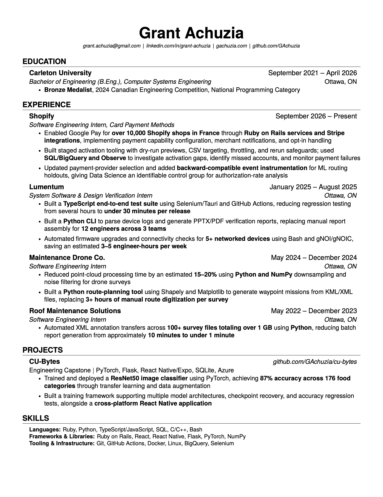

# Grant Achuzia's [Resume](build/Resume_GrantAchuzia.pdf)

Software engineering experience, projects, and education in one page.

## Build

With TeX Live (including `latexmk`) installed, run from the repository root:

```sh
latexmk -cd -pdf -interaction=nonstopmode -halt-on-error \
  -jobname=Resume_GrantAchuzia -outdir=../build src/resume.tex
```

The PDF is written to `build/Resume_GrantAchuzia.pdf`. Edit the sections in `src/`;
VS Code's LaTeX Workshop uses the same output name. On `main`, GitHub Actions
rebuilds the PDF and preview together. Pushing a `vX.Y.Z` tag creates a PDF release.
See [Updating and releasing the resume](docs/releases.md) for the steps.

## Preview


